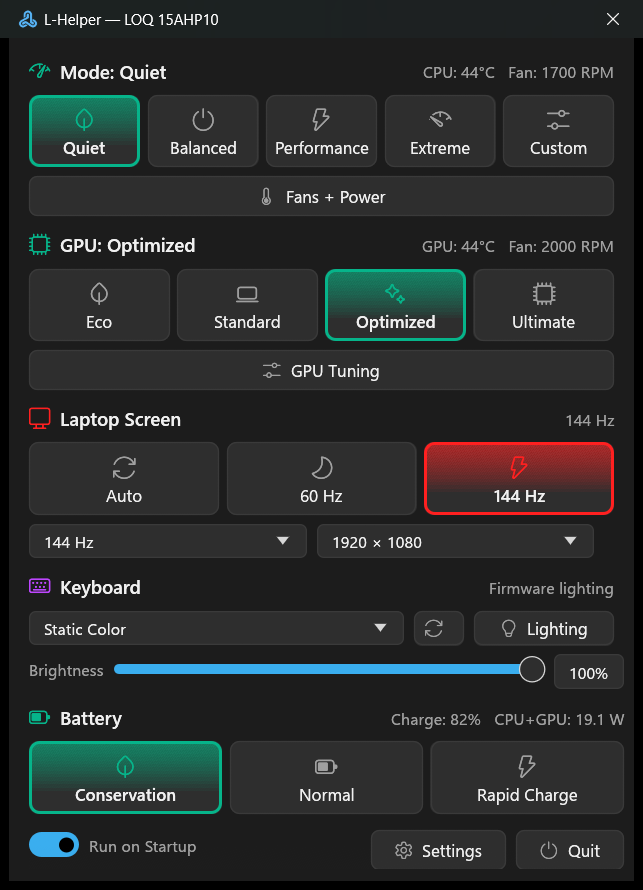
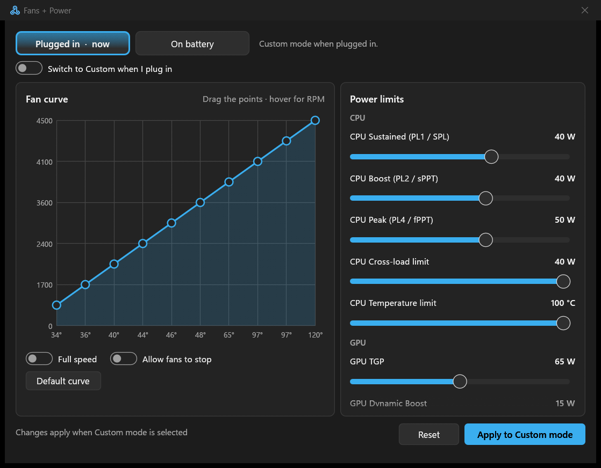
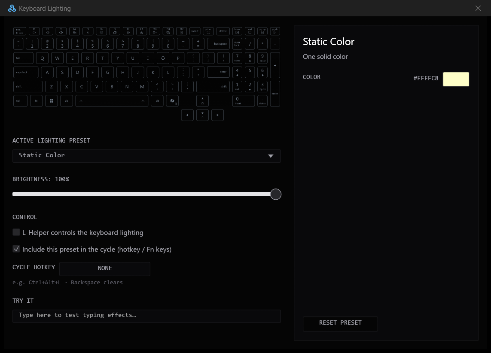
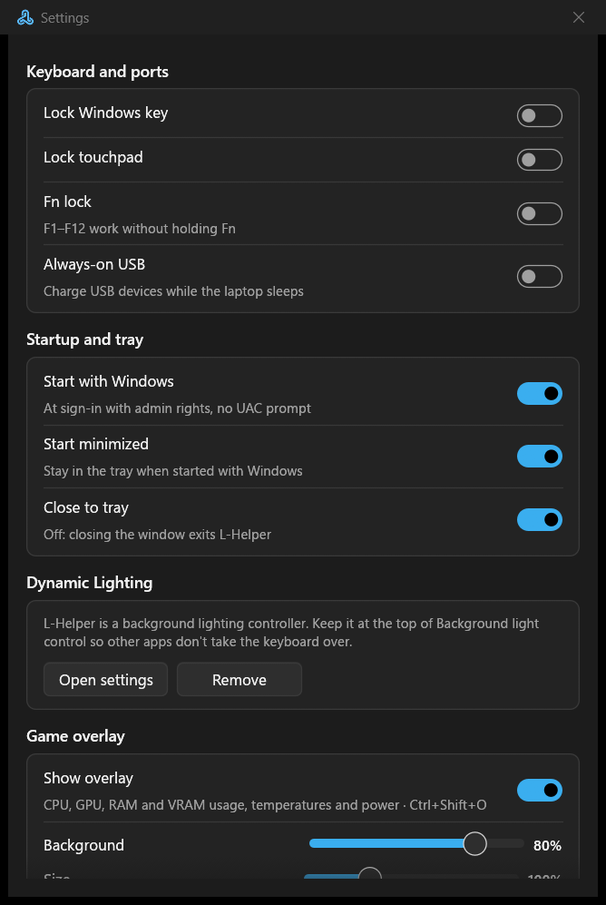

# L-Helper

A G-Helper-style control tool for **Lenovo LOQ, Legion and IdeaPad** laptops. It's a single native exe written in Rust, with no .NET runtime and no services.

<p align="center"></p>

Features:
- Performance modes and Custom mode, with fan curves and power limits
- GPU modes, plus GPU overclock and undervolt on supported NVIDIA GPUs
- Screen controls: refresh rate, resolution, overdrive and OLED care
- 24-zone keyboard lighting that works with Windows Dynamic Lighting
- Battery modes and power-source automations
- Game overlay
- Fn keys and on-screen popups
- BIOS and driver update check
- Lenovo software disabler

## Screenshots

| Fans + Power | Keyboard Lighting |
|---|---|
|  |  |
| **Settings** | **Game overlay** (Ctrl+Shift+O) |
|  |  |

> Hardware controls have been tested on a LOQ 15AHP10 (83JG). Other models may behave differently. Please attach `C:\ProgramData\LHelper\log.txt` to bug reports.

## Install

1. Download `L-Helper-<version>.msi` from [Releases](../../releases) and run it. SmartScreen may warn about an unsigned installer. If so, click **More info → Run anyway**.
2. Leave **Launch L-Helper** ticked at the end, and accept L-Helper's admin prompt. On its first start, L-Helper registers with Dynamic Lighting and restarts itself once.
3. In Windows Settings, open **Personalization → Dynamic Lighting → Background light control** and move L-Helper to the top.

The installer does three things:
- It puts L-Helper in `C:\Program Files\LHelper`.
- It adds a Start menu shortcut.
- It trusts the L-Helper signing certificate (`CN=LHelper`) for app packages on your PC.

The certificate is what lets Dynamic Lighting hand the keyboard to L-Helper in the background. To update, run the newer MSI. To uninstall, use **Settings → Apps → L-Helper → Uninstall**. That removes the program, the Dynamic Lighting registration, the certificate and the startup task.

Settings and logs live in `C:\ProgramData\LHelper`. Only administrators can write to that folder, and uninstalling keeps it.

**Portable alternative:** `L-Helper-<version>.zip` has the same exe without an installer.
1. Unzip the whole folder and run `lhelper.exe`.
2. Open **Settings → Dynamic Lighting → Register**, then click **Restart**.

## Build

Requires Rust (MSVC toolchain) on Windows.

```
cargo build --release
```

The output is `target\release\lhelper.exe`. The manifest asks for admin rights, because Lenovo's WMI methods and EnergyDrv require them.

Packaging scripts need the Windows SDK. The release script also needs the .NET SDK, because it gets WiX 5 through `.config\dotnet-tools.json`.
- `packaging\install.ps1` installs on this PC and registers the Dynamic Lighting package, for development. Run it as administrator.
- `packaging\release.ps1` builds `dist\L-Helper-<version>.msi` and the portable `.zip` for a GitHub release. Bump `version` in `Cargo.toml` first. The installer source is `packaging\installer\LHelper.wxs`.
- `packaging\uninstall.ps1` removes everything that `install.ps1` added. Run it as administrator.

The package is signed with a self-signed `CN=LHelper` certificate. It's kept in your CurrentUser certificate store. Back it up, and never commit the `.pfx` (see `packaging\pack.ps1`).

Command-line flags:
- `lhelper.exe -screenshot <folder>` renders every window to PNG plus the log, then exits. It's read-only.
- `lhelper.exe -screenshot <folder> -simulate ideapad` renders the IdeaPad UI on any machine.
- `lhelper.exe -autostart` starts hidden in the tray. The startup task uses this.

## Layout

```
src/
  main.rs            single instance, detection, tray, UI start
  app.rs             shared state, hardware worker thread, background loop, Fn key actions
  automation.rs      power-source rules
  mode.rs, gpu.rs    performance / GPU modes, Custom apply
  nvapi.rs           GPU overclock / undervolt
  updates.rs         Lenovo BIOS and driver catalog check
  wmi.rs             minimal WMI client over COM (method calls, queries, events)
  lenovo/            gamezone (+ capabilities), fans, energy (EnergyDrv), hid, keyboard, its (IdeaPad),
                     keys (Fn keys), machine (detection), sensors, software (disabler)
  lighting/          zone (24-zone HID driver), lamparray (Dynamic Lighting), effects, presets, samplers
  win/               display, oled, overlay, package (Dynamic Lighting registration), power, secure,
                     startup, toast, hotkey, toggles
  tray.rs            tray icon on its own message thread
  ui/                egui windows and G-Helper style widgets
packaging/           sparse package manifest, logos, install / release scripts
```

## Credits

- [G-Helper](https://github.com/seerge/g-helper) (GPL-3.0): UI concept
- [Lenovo Legion Toolkit](https://github.com/LenovoLegionToolkit-Team/LenovoLegionToolkit) (GPL-3.0): Lenovo WMI, driver, HID, display overdrive and GPU overclock knowledge
- [LOQ-24-zone-RGB-controller](https://github.com/DChitale/LOQ-24-zone-RGB-controller) (MIT, Dhruv Goel): 24-zone driver and lighting presets

See [THIRD_PARTY_NOTICES.md](THIRD_PARTY_NOTICES.md). Licensed under GPL-3.0-or-later ([LICENSE](LICENSE)).
